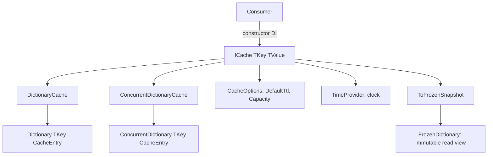
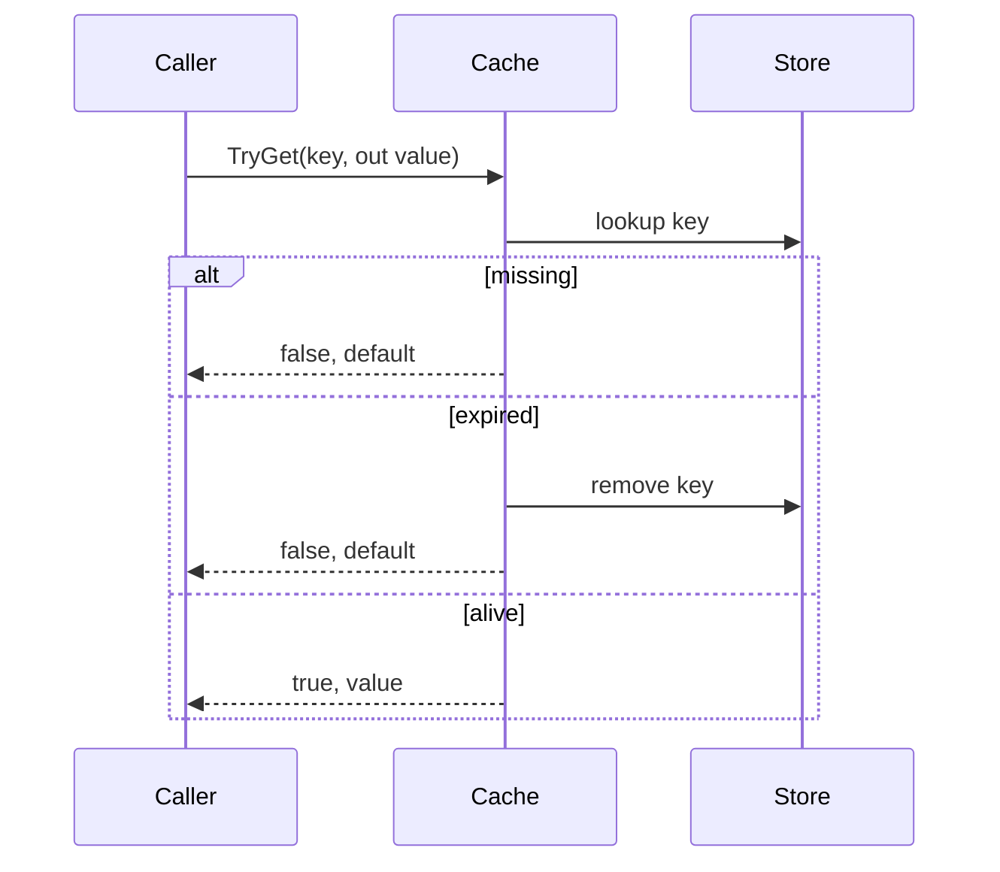
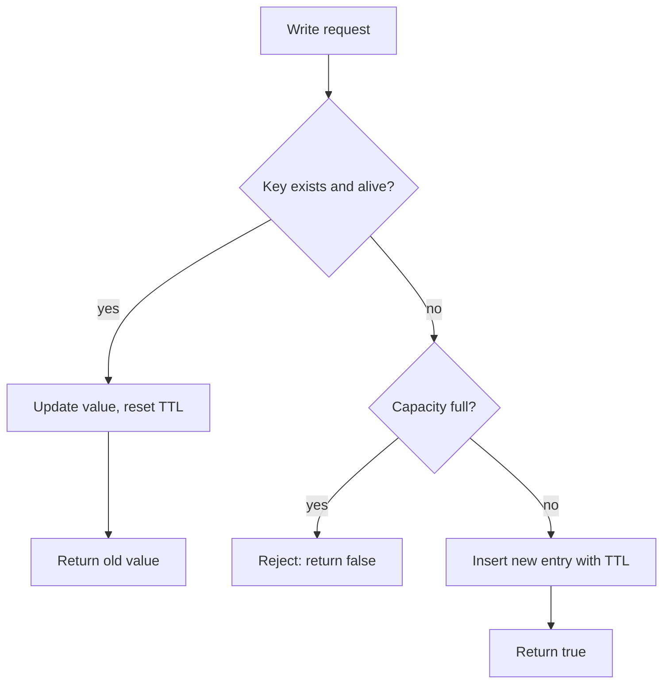
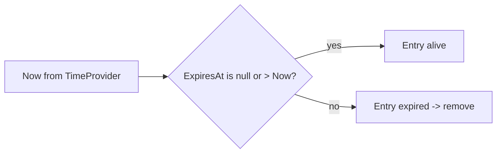
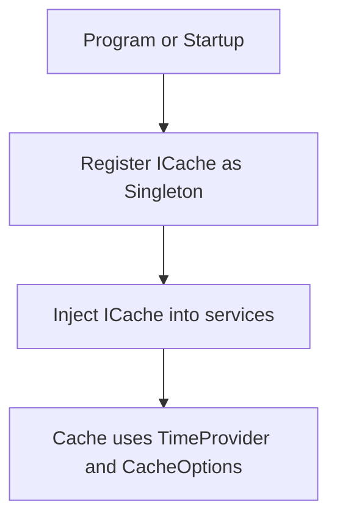
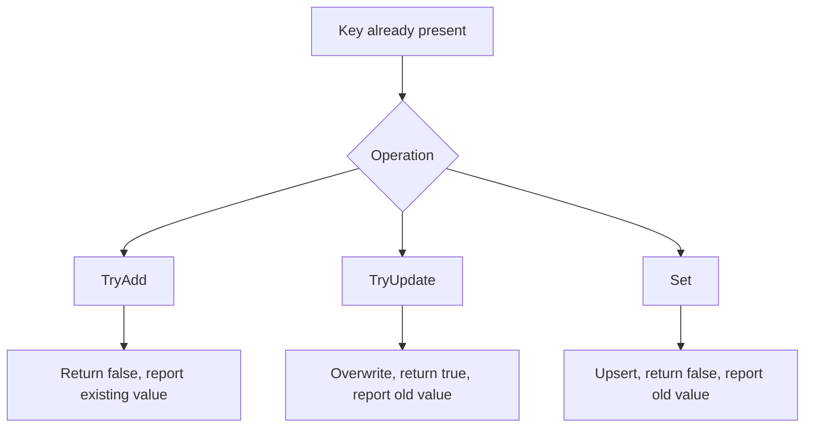

# In-Memory Cache (Dictionary vs ConcurrentDictionary)

## Category
Caching | Concurrency | Dependency Injection | OOP

## Question
Implement and demonstrate a simple in-memory caching mechanism in C#.

### Sub-questions / points from the panel
1. **Plain `Dictionary<TKey,TValue>` cache**
   - Fastest single-threaded option.
   - Not thread-safe; only one thread may read/write at a time.
2. **`ConcurrentDictionary<TKey,TValue>` cache**
   - Thread-safe for concurrent reads/writes.
   - Exposes async/await-friendly APIs (`Task`/`ValueTask`-style wrappers).
3. **Constructor dependency injection**
   - Inject `TimeProvider` (clock) and `CacheOptions` (TTL/capacity).
   - Register the cache as a **singleton** in the composition root.
4. **Why not (or when to) use `FrozenDictionary`?**
   - `FrozenDictionary` is immutable and read-optimized.
   - Good for static lookup tables, bad for a mutable cache.
   - Use `ToFrozenSnapshot()` to publish a read-only view.
5. **Why singleton design pattern?**
   - A cache must be shared application-wide.
   - Singleton lifetime shares one instance across all consumers.
6. **Why TTL (time-to-live)?**
   - Prevents stale data and unbounded memory growth.
   - Expiry is checked on read and during cleanup.
7. **Duplicate key but different value (key collision / key update)**
   - `TryAdd` reports the existing value and refuses to overwrite.
   - `TryUpdate` overwrites and reports the old value.
   - `Set` upserts and reports the old value.
8. **Nullable `out` parameter**
   - CRUD methods return `bool` and expose state via `out TValue?`.
   - For value types, `default` is returned instead of `null`.
9. **Return `bool` for every CRUD operation**
   - `true` = success, `false` = miss/full/collision as documented.

## Constraints
- Manual implementation first (no framework cache).
- Thread-safe variant must be safe for concurrent access.
- TTL checks must use an injectable clock (`TimeProvider`).
- Handle duplicate keys with different values (collision/update).
- Keep the library pure (no `Console`, return values only).

## API
- `ICache<TKey,TValue>` (where `TKey : notnull`):
  - `int Count { get; }`
  - `bool TryGet(TKey key, out TValue? value)`
  - `Task<(bool Success, TValue? Value)> TryGetAsync(TKey key, CancellationToken ct = default)`
  - `bool TryAdd(TKey key, TValue value)`
  - `bool TryAdd(TKey key, TValue value, out TValue? existingValue)`
  - `Task<bool> TryAddAsync(TKey key, TValue value, CancellationToken ct = default)`
  - `bool TryUpdate(TKey key, TValue value, out TValue? oldValue)`
  - `Task<(bool Success, TValue? OldValue)> TryUpdateAsync(TKey key, TValue value, CancellationToken ct = default)`
  - `bool TryRemove(TKey key, out TValue? value)`
  - `Task<(bool Success, TValue? Value)> TryRemoveAsync(TKey key, CancellationToken ct = default)`
  - `bool ContainsKey(TKey key)`
  - `bool Set(TKey key, TValue value, out TValue? oldValue)`
  - `void Clear()`
  - `FrozenDictionary<TKey,TValue> ToFrozenSnapshot()`

## Approach
1. Store each entry as `CacheEntry<TValue>` (value + expiry).
2. `DictionaryCache` for single-threaded scenarios.
3. `ConcurrentDictionaryCache` for thread-safe/async scenarios.
4. Lazy expiry cleanup on access and snapshot.

## Architecture (Mermaid)



## Read flow (Mermaid)



## Write flow (Mermaid)



## TTL expiry (Mermaid)



## Dependency injection (Mermaid)



## Duplicate key handling (Mermaid)



## Complexity
- Time: O(1) average for CRUD; O(n) for snapshot/cleanup.
- Space: O(n).

## Sample
```csharp
ICache<string, int> cache = new ConcurrentDictionaryCache<string, int>(
    TimeProvider.System,
    new CacheOptions(TimeSpan.FromSeconds(30)));

cache.TryAdd("a", 1);                 // true
cache.TryAdd("a", 2, out var existing); // false, existing = 1
cache.TryUpdate("a", 9, out var old);  // true, old = 1
cache.Set("b", 2, out _);             // true
var snapshot = cache.ToFrozenSnapshot(); // immutable view
```

## Demo
Menu key in `MainConsoleApp/Program.cs`: `["7"] = ("In-memory cache (Dictionary vs ConcurrentDictionary)", DemoCache)`.

## Tests
`CSharpCodePractice.Tests/Caching/InMemoryCacheTests.cs`
- Constructor null guards.
- Miss/add/update/remove/set.
- Duplicate key reporting.
- TTL expiry and re-add.
- Capacity rejection.
- Frozen snapshot filtering.
- Async round-trip.
- Clear.

## Code reading guide (file order)
1. `ICache.cs` - contract and method semantics.
2. `CacheEntry.cs` - stored value + expiry.
3. `CacheOptions.cs` - TTL and capacity.
4. `DictionaryCache.cs` - single-threaded implementation.
5. `ConcurrentDictionaryCache.cs` - thread-safe/async implementation.
6. `InMemoryCacheTests.cs` - behavior and edge cases.
7. `PROBLEM.md` - this document.

## Notes
- `notnull` is a generic constraint, not a keyword.
- `// shortcut:` marks deliberate simplifications with a known ceiling.
- `FrozenDictionary` is immutable: use for static lookups, not mutable caches.
EOF